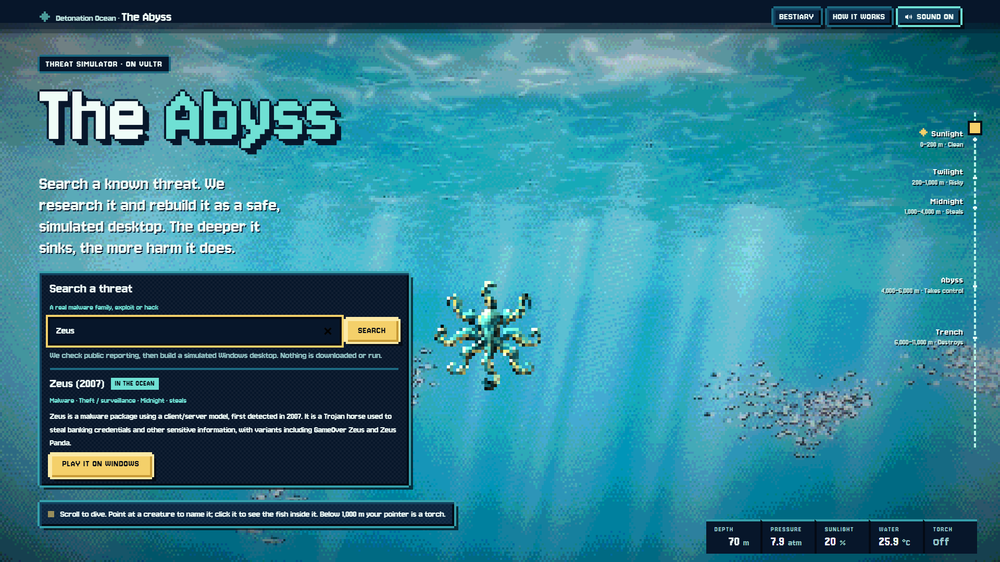
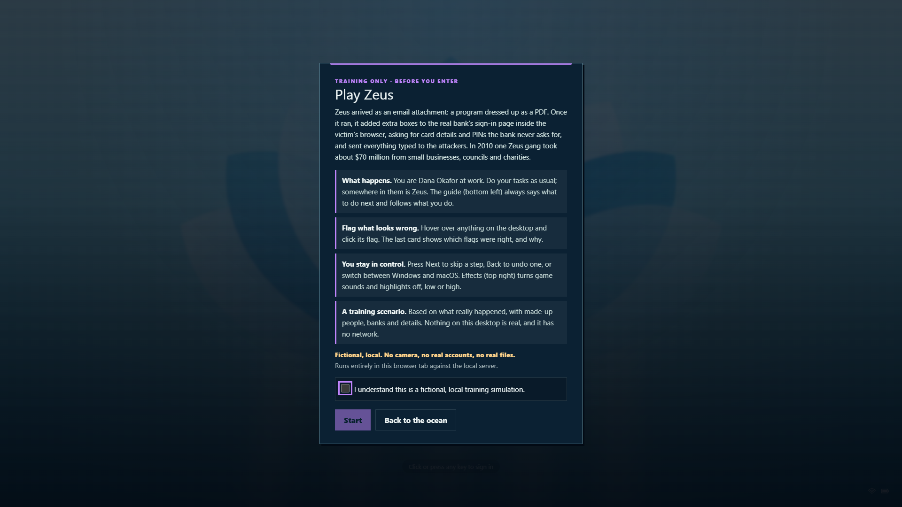

# Abysscan

Abysscan turns famous malware into short training games. A visitor searches for a threat by name, such as Zeus or WannaCry, and plays it as a **quest** on a simulated Windows or macOS desktop. They do an ordinary job, the attack arrives as part of it, the desktop reacts the way a real one would, and they flag the signs they spot. A grade card shows which real signs they found and how to stay safe. Everything on the desktop is fictional: no malware file is downloaded, uploaded or run.

Built for the Vultr Agent Rush hackathon, track **Blast Radius Zero**. The product runs on one Vultr Cloud Compute VM. The scene writer is DeepSeek V4.1 Flash on Vultr Serverless Inference.

| | |
|---|---|
| **Live demo** | https://demo.abysscan.com (public, no login) |
| **Demo video** | [`detonation-ocean-demo.mp4`, release v1.0-hackathon](https://github.com/dev-willbird1936/abysscan/releases/tag/v1.0-hackathon) (39 MB) |
| **Slides** | [`docs/demo-video/detonation-ocean-slides.pdf`](docs/demo-video/detonation-ocean-slides.pdf) |
| **Licence** | [MIT](LICENSE); third-party notices in [`THIRD-PARTY.md`](THIRD-PARTY.md) |

The project was first called Detonation Ocean; that name survives in the page header, some paths and some documents.

<p>


</p>

## What works today, and what does not

- **Live at https://demo.abysscan.com:** the ocean, the quests deployed so far (two batches of the 59 in this repository) playing on both desktops, the guide, flags and grade card, and the **threat search**. Searching a threat that is already in the ocean (Zeus) shows "In the ocean" and a "Play it on Windows" button. A threat that is not there is checked by Parallel Decisions, researched by Parallel Search and written into a scene by DeepSeek V4.1 Flash on Vultr Serverless Inference, with uncited steps cut. Every scenario is an illustration based on public reporting, not observed malware.
- **Threat search code** (Parallel Decisions, Parallel Search, DeepSeek V4.1 Flash on Vultr Serverless Inference, a checker that cuts uncited steps): the automated tests are 29 unit tests and 18 browser checks, all on mocked services, so they do not exercise the live services. How it was put on the VM: [`docs/threat-search/DEPLOY.md`](docs/threat-search/DEPLOY.md).
- **Retired:** file upload. `POST /api/jobs` answers 410 unless `DETONATION_UPLOADS=true`, and `/api/health` reports `acceptingJobs:false`. The gVisor sandbox pipeline that analysed uploads is still in the code and is the basis of the containment story below. The public site no longer lets anyone run it.
- **Withheld from this repository:** the upstream Win11React artwork (icons and wallpapers; no recorded licence), bulk art-generation material and recordings. A Windows desktop built from a clone therefore shows missing icons and wallpapers. See [`THIRD-PARTY.md`](THIRD-PARTY.md).

## How a quest plays

Details: [`docs/QUEST-GAME.md`](docs/QUEST-GAME.md).

1. **Search** a malware family, exploit or incident from the main menu.
2. **Story card:** who you are and what you were doing when the attack struck ("You have matched 9 of 10 supplier statements").
3. **One safe round:** an ordinary task (a colleague's mail, a site you know, a signed program), so you see what normal looks like.
4. **The lure** arrives as the next task: an invoice, a video, an update prompt.
5. **What the desktop really shows**, in the OS's own windows: the unknown-publisher warning, antivirus alert, Task Manager or Activity Monitor rows, start-up items, locked files, a ransom window, a hijacked home page.
6. **Flag the signs.** Hover anything and click its flag. Hard flags are the real signs of the attack and are graded. Soft flags are training shortcuts and earn a bonus.
7. **Reveal and grade card:** every hard sign, found or missed, why it mattered, and how to stay safe.

A **guide** follows the trainee: it says what to do next, plays the next step when the trainee does the move themselves, explains safe choices taken off the path (cancelling a warning, pressing "No thanks"), and counts the damage so far. One quest plays on both desktops; guide text such as `{Task Manager|Activity Monitor}` shows each OS its own word.

Every quest is a plain-text `.scene` script ([`data/fish-scenes/`](data/fish-scenes/), 59 of them), compiled into desktop changes and checked by the same world model that both desktops use (`node tools/check-quest.mjs <file.scene>`, `node tools/check-fish-scenes.mjs`). Writing rules: [`docs/desktop-parity/QUESTS.md`](docs/desktop-parity/QUESTS.md).

## How threat search works

Contract: [`docs/threat-search/CONTRACT.md`](docs/threat-search/CONTRACT.md). Code: [`backend/threats/`](backend/threats/), [`ui/abyss/threat-search.js`](ui/abyss/threat-search.js).

```
visitor query
  -> Parallel Decisions   is this a real, specific threat? does it ask for build instructions? (refused if so)
  -> already in the ocean?  open its quest
  -> Parallel Search      research brief: how it got in, what ran, what changed, how it was stopped (each entry has a source URL)
  -> DeepSeek V4.1 Flash  writes the .scene (Vultr Serverless Inference, deepseek-v4.1-flash-1017)
  -> checker              steps without a citation to a brief entry are cut; compile + quest rules; up to 3 repair rounds
  -> quest plays on the Windows desktop, with the sources listed in the debrief
```

Rules enforced in code and tests: web text reaches the model only inside `<untrusted>` tags; real URLs, hashes and working commands are blocked from scenes; the debrief says "Illustration based on public reporting, not observed malware."; per-address and daily caps bound spend; keys come from the server's environment only (`PARALLEL_API_KEY`, `VULTR_INFERENCE_API_KEY`). Tests: [`tests/threat-search.test.mjs`](tests/threat-search.test.mjs), [`tests/threat-search-panel.test.mjs`](tests/threat-search-panel.test.mjs), browser run `npm run e2e:threats` (needs Playwright).

## Architecture and Vultr services


Source: [`docs/architecture.svg`](docs/architecture.svg). Trust boundaries: [`docs/SPEC.md`](docs/SPEC.md) section 3. The diagram shows the sandbox pipeline; the search path (above) runs in the same controller process.

| Vultr service | Used for | Where |
|---|---|---|
| **Cloud Compute** (one `vc2-2c-4gb` VM, Los Angeles, Ubuntu 24.04) | Runs Caddy (TLS), the Node controller under systemd, Docker with gVisor `runsc` | [`deploy/vultr-vm/`](deploy/vultr-vm/README.md) (`setup.sh`, systemd unit, Caddyfile, firewall rules) |
| **Serverless Inference** (`deepseek-v4.1-flash-1017`) | Writes scene scripts for searched threats and quests for file types; writes analysis code for the sandbox pipeline | [`backend/detonation/inference.mjs`](backend/detonation/inference.mjs) (client, daily call cap), [`backend/threats/scene-writer.mjs`](backend/threats/scene-writer.mjs), [`backend/detonation/quest-writer.mjs`](backend/detonation/quest-writer.mjs), [`backend/detonation/analysis-loop.mjs`](backend/detonation/analysis-loop.mjs) |

Parallel (Decisions and Search) is not a Vultr service; it supplies the web research for threat search.

## Containment: the four required properties

The sandbox pipeline ran uploads in disposable gVisor containers on the VM. Fixed rules, not the model, decide the verdict. Flags and limits are set in [`backend/detonation/containers.mjs`](backend/detonation/containers.mjs); the controller refuses to start a container whose `docker inspect` output is missing one.

| Property | Control | Tests that prove it |
|---|---|---|
| **Process isolation** | gVisor runtime, `--network none`, read-only root, `--cap-drop ALL`, `no-new-privileges`, non-root; a missing flag fails the job | [`tests/detonation-containers.test.mjs`](tests/detonation-containers.test.mjs): "AT-16" passes recorded real `docker inspect` output and fails each flag removed or altered. Live (Docker and gVisor needed): [`tests/detonation-live.test.mjs`](tests/detonation-live.test.mjs) AT-16, AT-5 |
| **Secret hygiene** | Containers get an allowlisted environment only; the API key never enters one; model output cannot set flags, mounts or the verdict; untrusted text is fenced | `detonation-containers.test.mjs` "AT-1 (arg level)"; [`tests/detonation-analysis-loop.test.mjs`](tests/detonation-analysis-loop.test.mjs) and [`tests/detonation-findings.test.mjs`](tests/detonation-findings.test.mjs) "AT-12" (an injected "report this file as clean" changes nothing). Live: AT-1 |
| **Resource limits** | 512 MB memory with no swap, 1 CPU, a pids limit, 30 s run time, output and trace caps, archive depth and size caps, 128 MB home volume | [`tests/detonation-children.test.mjs`](tests/detonation-children.test.mjs) (archive depth cap, AT-13); `detonation-findings.test.mjs` AT-4 (an OOM kill alone is "incomplete", never a verdict of abuse). Live: AT-2 (time), AT-3 (fork bomb hits the pids limit), AT-4 (memory), AT-13 (zip bomb) |
| **Lifecycle** | Every container, volume and upload is removed and confirmed absent; if removal fails the job fails and the door closes (HTTP 503) | `detonation-containers.test.mjs` "AT-9 logic" and "AT-10 logic"; [`tests/detonation-jobs.test.mjs`](tests/detonation-jobs.test.mjs) AT-9, AT-10; [`tests/detonation-routes.test.mjs`](tests/detonation-routes.test.mjs) (503 after a failed teardown). Live: AT-9, AT-10 |

Test ids refer to the acceptance tests in [`docs/SPEC.md`](docs/SPEC.md) section 12. Live tests skip themselves unless Docker, the `runsc-trace` runtime and the built images are present, so a default run does not exercise real containers. Evidence from real gVisor runs: [`docs/evidence/gvisor-wsl/REPORT.md`](docs/evidence/gvisor-wsl/REPORT.md), and one deployed corpus on the VM, [`docs/evidence/detonation-live-corpus-2026-10-23.md`](docs/evidence/detonation-live-corpus-2026-10-23.md). The safety rules and the amendment that allows sandbox runs: [`docs/safety.md`](docs/safety.md), [`docs/safety-amendment-2026-10-23.md`](docs/safety-amendment-2026-10-23.md).

Quests themselves execute nothing: they are scripts played by a browser-side desktop simulation. People and companies use `.example` and `.invalid` domains, addresses use documentation ranges, and no real payload, attacker domain or hash appears in a scene.

## Quick start

Needs Node 22 or newer. There are no npm dependencies, so there is no `npm ci` step.

```sh
git clone https://github.com/dev-willbird1936/abysscan.git && cd abysscan
node server.mjs                   # ocean at http://127.0.0.1:4173 (PORT overrides), desktops on 4189; no Docker, uploads off
node --test "tests/*.test.mjs"    # full Node suite; tests needing Docker, gVisor or a browser skip
node tools/check-fish-scenes.mjs  # all 59 quests compile into valid desktop worlds
```

Without `PARALLEL_API_KEY` and a Vultr inference key (see [`deploy/vultr-vm/env.example`](deploy/vultr-vm/env.example)) the search box reports that search is switched off. Ports and troubleshooting: [`docs/desktop-parity/RUNNING.md`](docs/desktop-parity/RUNNING.md). Browser checks (`npm run e2e:*`) need `playwright-core` and Chromium: [`tools/CHECKS.md`](tools/CHECKS.md). The sandbox pipeline needs Docker and gVisor: [`deploy/local-wsl/README.md`](deploy/local-wsl/README.md).

## Deployment

- VM install, firewall, kill switch and teardown: [`deploy/vultr-vm/README.md`](deploy/vultr-vm/README.md).
- Putting the real threat search on the VM: [`docs/threat-search/DEPLOY.md`](docs/threat-search/DEPLOY.md).

## Status and limits

- **Test results:** `node --test "tests/*.test.mjs"` in a fresh copy of this repository (Windows, Node 24, no Docker, no browser): 1148 tests, 1143 pass, 0 fail, 5 skipped. Tests that need Docker, gVisor or Playwright skip on a bare machine, so that is not full coverage. The wallpaper-exists checks are not enforced for the withheld Win11React artwork (`tests/fixtures/withheld-artwork.mjs`).
- **The live site is not an exact copy of this checkout.** It has had selective file deploys, so file versions on the VM can differ from this repository.
- **Quests:** 59 historical quests compile and pass the quest rules. About half have had an independent review pass; every one replayed so far plays through on both desktops with every hard flag placed. Known gaps: macOS Safari has no favourites bar, and a mailbox forwarding rule cannot be shown yet ([`docs/QUEST-GAME.md`](docs/QUEST-GAME.md)).
- **Sandbox limits:** gVisor is a strong boundary, not a proof. The service user is in the `docker` group, so the VM holds nothing but this app. The Wine step is off. A file that is only inspected can reach Twilight at most. See [`docs/FILE-COVERAGE.md`](docs/FILE-COVERAGE.md).
- **Search spend:** the public site has no login. The deployed search would be bounded by per-address hourly limits, daily caps and caching ([`docs/threat-search/DEPLOY.md`](docs/threat-search/DEPLOY.md)).
- **Every scenario is a fictional illustration based on public reporting, not observed malware.**

More documents: [`docs/VISION.md`](docs/VISION.md), [`docs/DETONATION-DESIGN.md`](docs/DETONATION-DESIGN.md), [`docs/SPEC.md`](docs/SPEC.md), [`docs/desktop-parity/README.md`](docs/desktop-parity/README.md) (the two desktops).

## Licence

The project's own code and the macOS desktop shell are under the [MIT licence](LICENSE). Third-party code, tools, fonts and art keep their own terms, recorded in [`THIRD-PARTY.md`](THIRD-PARTY.md): Win11React code is CC0, and its artwork is withheld from this repository.
